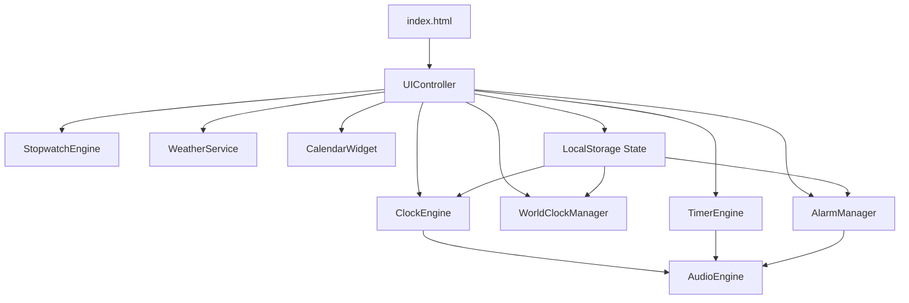

# ⏰ ChronoLuxe • Premium Digital Clock & Time Intelligence Dashboard
### SpireX Foundation Internship — Task 6 Submission

A modern, responsive, all-in-one **Digital Clock & Time Intelligence Dashboard** built strictly with **semantic HTML5**, **modular CSS3**, and **vanilla ES6+ JavaScript** (zero external frameworks or UI libraries).

Designed with a **futuristic glassmorphism aesthetic**, **neon accents**, and deep navy space themes, ChronoLuxe brings together precision timekeeping, world time zones, a high-performance stopwatch, a circular countdown timer, a smart alarm manager, live weather synchronization, and an interactive full calendar.

---

## 🌟 Comprehensive Feature Matrix

### 1. 🕒 Core Real-Time Digital & Analog Clock
- **Real-Time Digital Precision**: Displays hours, minutes, seconds, and AM/PM with zero-lag updates via `setInterval()`.
- **Dual Format Switcher**: Seamless 12-hour (with AM/PM) and 24-hour military time formats.
- **Full Calendar Date**: Displays current weekday, month name, date, and year.
- **Dynamic Greetings**: Time-of-day greeting (e.g. *Good Morning 🌅*, *Good Afternoon ☀️*, *Good Evening 🌆*, *Good Night 🌙*).
- **Animated Analog Clock**: Smoothly moving hour, minute, and second hands with real-time angle calculation:
  - Hours: `(hours % 12) * 30 + minutes * 0.5`
  - Minutes: `minutes * 6 + seconds * 0.1`
  - Seconds: `seconds * 6`
- **60-Second Real-Time Pulse**: Glowing progress bar reflecting the exact second within the minute.
- **Day Progress Tracker**: Percentage gauge reflecting the elapsed portion of the 24-hour day.

### 2. 🌍 International World Clock
- **Live Multi-Timezone Cards**: Pre-loaded with global business hubs (New York, London, Paris, Dubai, Tokyo, Sydney).
- **Searchable / Selectable Dropdown**: Easily add new cities across international standard IANA timezones.
- **Live Local Time Difference**: Real-time relative offset badge (e.g., `+5h ahead`, `-3h behind`, or `Same time`).
- **City Card Removal**: Instant deletion with real-time recalculation.
- **Persistent Storage**: Retains your configured world clocks in `localStorage`.

### 3. ⏱️ Millisecond Precision Stopwatch
- **High-Precision Timing**: Accurate tracking of Hours, Minutes, Seconds, and Centiseconds (hundredths of a second) using `Date.now()` delta timestamps.
- **Split & Lap Recording**: Records unlimited lap times while running.
- **Smart Lap Analysis**: Automatically flags and highlights the **Fastest Lap** (green) and **Slowest Lap** (red).
- **Controls**: Start, Pause, Resume, Reset, and Clear Laps.

### 4. ⏳ Circular Countdown Timer
- **Animated SVG Progress Ring**: Dynamic stroke-dashoffset calculation:
  $$\text{offset} = \text{circumference} \times (1 - \text{fractionRemaining})$$
- **Quick Preset Buttons**: Instant 1-minute, 5-minute, 15-minute, 25-minute (Pomodoro study technique), and 1-hour presets.
- **Customizable Duration**: Custom numerical inputs for Hours, Minutes, and Seconds.
- **Alarm Alert on Completion**: Triggers an automatic melodic audio chime and modal alert upon reaching zero.

### 5. 🔔 Smart Alarm Manager
- **Complete CRUD Functionality**: Add, view, edit, and delete scheduled alarms.
- **Customizable Attributes**: Time (HH:MM), custom reminder labels, and recurring day selector (Sun through Sat).
- **Enable / Disable Toggle Switches**: Smooth toggle switches for quick activation/deactivation.
- **Audio Chime Synthesizer**: Melodic multi-note arpeggio via the browser's native **Web Audio API** (no external audio files needed).
- **Desktop Notifications**: Native browser Notification API dispatch when enabled.
- **Snooze & Dismiss System**: Dismiss or snooze for 5 minutes with a single click.

### 6. 🌤️ Weather Forecast Widget
- **Free Open-Meteo Integration**: Fetches real-time temperature, condition, humidity, and wind speed without requiring any API keys.
- **Geolocation & Default Fallback**: Automatically tries user coordinates or defaults gracefully to standard coordinates.
- **Resilient Offline Architecture**: If network is blocked or offline, displays realistic simulated weather data with an informative badge so the UI never crashes.
- **Manual Refresh**: Interactive refresh button to pull the latest forecast on demand.

### 7. 📅 Interactive Full Month Calendar
- **Dynamic Month Matrix**: Accurately computes day layouts, including previous and next month boundary filler days.
- **Current Day Highlighting**: Glowing accent badge for today's date.
- **Month Navigation**: Previous Month, Next Month, and "Current Month" jump buttons.
- **Date Information Sidebar**: Select any day to view the full date string, day of week, day of the year ($X / 365$), week of the year, and total days in month.

### 8. 🎨 Design, Themes & UX Polish
- **Dark Mode & Light Mode**: Instant toggle between deep dark navy space theme and soft frosted glass daylight theme.
- **5 Custom Neon Accent Themes**:
  - ⚡ Cyber Cyan (`#00f2fe`)
  - 🔮 Neon Purple (`#c084fc`)
  - 🟢 Matrix Emerald (`#10b981`)
  - 🟡 Solar Amber (`#fbbf24`)
  - 💖 Electric Pink (`#f43f5e`)
- **Fullscreen Clock Mode**: Immersive full-window display ideal for desk monitors or presentations (press `F` or click button).
- **Audio Synthesizer Engine**: Synthesized mechanical clicks, button tones, and alarm melodies using native `AudioContext`.
- **Keyboard Shortcuts**:
  - `1 - 6`: Instant navigation between tabs
  - `F`: Toggle Fullscreen Mode
  - `M`: Toggle 12H / 24H Format
  - `S`: Toggle Audio Feedback
  - `T`: Cycle Neon Color Theme
  - `Esc`: Exit Fullscreen or dismiss modal

---

## 📁 Clean File Structure

```
TASK-6/
│
├── index.html       # Semantic HTML5 dashboard layout, tab panels, SVG icons & modals
├── style.css        # CSS Custom Properties, Glassmorphism, animations, analog watch & responsive queries
├── script.js        # Modular vanilla JavaScript engine (Audio, Clock, World Clock, Stopwatch, Timer, Alarm, Calendar, Weather)
└── README.md        # Comprehensive documentation, setup, and submission guide
```

---

## 🚀 How to Run the Project Locally

No external packages, node modules, compilers, or bundlers are required. The dashboard runs in any modern browser (Chrome, Edge, Firefox, Safari, Brave, Opera).

### Method 1: Direct File Launch (Quickest)
1. Navigate to the project directory:
   ```
   C:\Users\Admin\Downloads\TASK-6\
   ```
2. Double-click `index.html` to open it in your default web browser.

### Method 2: VS Code Live Server
1. Open the `TASK-6` folder inside **Visual Studio Code**.
2. If installed, right-click `index.html` and select **"Open with Live Server"**.
3. Access the dashboard at `http://127.0.0.1:5500/index.html`.

### Method 3: Local Python HTTP Server
Open PowerShell or your command line inside `C:\Users\Admin\Downloads\TASK-6` and run:
```bash
# Python 3
python -m http.server 8080
```
Then visit `http://localhost:8080` in your web browser.

---

## 🌐 Free One-Click Deployment Options

### Option A: GitHub Pages
1. Push this folder to a GitHub repository:
   ```bash
   git init
   git add .
   git commit -m "Task 6: ChronoLuxe Digital Clock Dashboard"
   git branch -M main
   git remote add origin https://github.com/<your-username>/spirex-task-6-clock.git
   git push -u origin main
   ```
2. Go to **Settings** → **Pages** → Source: **Deploy from a branch** (`main` / root).
3. Your live link will be: `https://<your-username>.github.io/spirex-task-6-clock/`.

### Option B: Netlify or Vercel
- **Netlify**: Drag-and-drop the `TASK-6` folder directly into [Netlify Drop](https://app.netlify.com/drop) for instant deployment with a free public URL.
- **Vercel**: Run `npx vercel` inside the folder or import the GitHub repository.

---

## 🧑‍💻 Technical Architecture & Code Highlights



- **Audio Synthesis**: Pure Web Audio API eliminates the need for MP3 files that fail to load due to CORS or local filesystem restrictions.
- **Zero Framework Footprint**: 100% written in modern vanilla ES6+ standards, proving mastery of native DOM manipulation, browser storage, and standard CSS3 specifications.
- **Error Resilient**: All external endpoints (e.g. Open-Meteo) have `try-catch` wrappers with graceful fallbacks.

---

## 📋 SpireX Foundation Task 6 Checklist Compliance

- [x] Pure HTML5, CSS3, and vanilla JavaScript (no React, Bootstrap, or Tailwind).
- [x] Real-time digital clock with hours, minutes, seconds, and AM/PM.
- [x] 12-hour and 24-hour format switcher.
- [x] Live full calendar date (weekday, month, date, year).
- [x] Dynamic greetings based on current time.
- [x] Animated analog clock with moving hour, minute, and second hands.
- [x] Multiple world clocks with selectable time zones and relative offset.
- [x] High-precision stopwatch with lap recording, fastest/slowest lap detection.
- [x] Countdown timer with customizable duration and circular progress ring.
- [x] Alarm manager with add, edit, delete, enable/disable switches.
- [x] Alarm audio chime and snooze/dismiss modal.
- [x] Weather widget with Open-Meteo API and offline fallback.
- [x] Calendar with month navigation and current day highlighting.
- [x] Dark mode and Light mode toggle.
- [x] 5 Custom neon accent color themes.
- [x] Fullscreen presentation mode.
- [x] `localStorage` persistence for user preferences, alarms, and cities.
- [x] Responsive layout across desktop, tablet, and mobile.
- [x] Separated into `index.html`, `style.css`, and `script.js`.
- [x] Production-quality, modular, and error-free code suitable for portfolio and internship submission.
# DIGITAL-CLOCK

